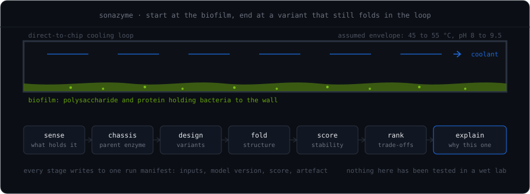

<div align="center">

# Sonazyme

**Sonar for the slime. AI-designed enzymes that still fold in the pipe.**

[](LICENSE)
&nbsp;[](https://github.com/Nabzx/sonazyme/actions/workflows/ci.yml)
&nbsp;
&nbsp;

</div>

<p align="center">
  
</p>

**We use sonar to detect biofilm build-up in cooling pipes, then release
enzymes designed to break it down.**

Data centres pull heat out of GPUs with water. Bacteria live in that water and
glue themselves to the inside of the pipe in a layer called a biofilm. The
layer insulates the metal, narrows the channel and feeds corrosion, so
operators dose the loop with biocide. The biocide kills the cells on the
surface and leaves the glue, and the film grows back.

Sonazyme designs enzymes that cut the glue instead, and that are redesigned to
hold their shape in a loop running hot and alkaline. It is a design and
triage tool for industrial biotech partners, not a product you pour into a
pipe. Nothing here has been tested in a wet lab.

> Think of Sonazyme like a doctor using an ultrasound scan (acoustic waves) to
> spot a blockage inside a patient, and then prescribing a custom medicine
> (an AI-designed enzyme, structure predicted with Boltz-2) to dissolve it.

## Why off-the-shelf enzymes do not work

An enzyme is a protein, and a protein is a folded chain. The fold is the tool.
Heat and pH shake the chain until the fold is lost, which is denaturing, and a
denatured enzyme does nothing. Cleaning enzymes sold today are tuned for a
washing machine or a food plant, not for the conditions inside a cooling loop,
so the obvious candidates are the wrong shape within minutes of being dosed.

Two routes out of that. **Rigidify**: keep the same job, change the parts of
the chain that give way first, so the fold survives the loop. **Pre-compensate**:
predict how the fold shifts under load and aim off, so it lands correct once it
is hot. Sonazyme takes the rigidify route, for the reasons in
[ADR-0003](docs/adr/0003-rigidify-not-pre-compensate.md). Pre-compensation is
written down as a research direction, not a claim.

## What it does

| Stage | What happens | What it writes |
| --- | --- | --- |
| `sense` | name the bond that holds the target biofilm together, and later, read the loop to find where the film is | a target definition and a condition envelope |
| `chassis` | pick parent enzymes that cut that bond | candidate sequences with their sources |
| `design` | propose variants of each parent, via Tamarind Bio | a variant set with the mutations made |
| `fold` | predict each variant's structure, via Boltz-2 | structures and confidence |
| `score` | predict stability in the envelope, and check the active site survived | a stability estimate and an integrity flag |
| `rank` | trade stability against activity and confidence | an ordered shortlist with the trade-offs shown |
| `explain` | answer questions about the shortlist from the run's own artefacts | a cited answer, never a canned one |

Every stage appends to one run manifest: inputs, model and version, score,
artefact path. The dashboard and the agent read the manifest, so anything
either of them says can be traced back to the run that produced it
([ADR-0004](docs/adr/0004-provenance-on-every-number.md)).

## Sensing the loop

A cooling loop is a sealed box. Nobody can see inside it while it runs, so
treatment is dosed on a schedule rather than on evidence, and the first sign
of a problem is usually a performance number drifting.

Ultrasonic and guided-wave methods are already used to find deposits in pipes
from the outside: a layer on the inner wall changes the impedance at the wall,
so the echo and the time of flight change with it. Pointed at a loop, that
gives a map of where the film is thickening, which says where to dose, which
section to sample, and whether a treatment did anything.

That is the sonar half of the name, and it is the direction the project is
committed to, not something it has built. None of it exists yet. The hard
question is whether the signal can tell a soft water-rich biofilm from hard
scale or corrosion product, and that question is open:
[#68](https://github.com/Nabzx/sonazyme/issues/68). The scope is fixed by an
ADR before any of it is claimed
([#57](https://github.com/Nabzx/sonazyme/issues/57)), and until a retrodiction
case passes, anything shown is labelled as a demonstration of the method
rather than as a measurement.

## Targets are data, not code

The biofilm in a cooling loop is not one thing. Composition changes with the
water, the metal, the temperature and the biocide history, so the target is a
file, not a hard-coded assumption
([ADR-0002](docs/adr/0002-targets-are-data.md)). A target definition names the
organism or community, the structural components that hold the film together,
the bond each component offers, and the envelope the enzyme must work in.

The default target is a *Pseudomonas*-style loop film, with a
sulfate-reducing community as the corrosion case. Swapping to a different
film, or to a marine hull or a spacecraft water loop, is a new file in
`targets/`, not a new pipeline.

## The tools

| Job | Tool |
| --- | --- |
| Variant design and optimisation | Tamarind Bio |
| Structure and interaction prediction | Boltz-2 |
| Stability scoring and the refinement loop | Adaption Labs |
| Explaining a candidate from run artefacts | the Sonazyme scientist agent |

Integration notes, including what each tool is trusted for and what it is not,
are in [docs/platform/](docs/platform).

## The dashboard

Sonazyme Lab is a web app, specified in
[docs/design/dashboard.md](docs/design/dashboard.md), built around five
screens: the problem, the baseline enzyme and where it denatures, the live
redesign with candidates arriving and scored, a question to the agent answered
from real output, and the case for the approach. The app lives in
[`web/`](web).

## New to the biology

[`docs/biology/`](docs/biology) explains every biological idea this repo
depends on, at GCSE level, in order. Enzymes and active sites, why shape is
everything, what denaturing is, what a biofilm is made of, which enzyme cuts
which part of it, what a mutation does to stability, and how structure
prediction fits in. Read it before the architecture if the word polysaccharide
is doing a lot of work for you.

## What this is not

- Not a treatment. No dosing advice, no claim of efficacy in a real loop.
- Not a wet-lab result. Every number here comes from a model.
- Not a biocide replacement until something has been measured. The honest
  claim is a shortlist worth testing, nothing further.
- Not work on anything that makes an organism more harmful. See
  [SECURITY.md](SECURITY.md).

## The environmental case

Loop treatment today is chemical: oxidising biocides, non-oxidising biocides,
dispersants and the blowdown that carries them out of the building. An
enzyme that cuts the glue is dosed in smaller amounts, works on the film
rather than on everything in the water, and breaks down into sugars and amino
acids rather than persisting in discharge. Cleaner heat transfer also means
less pump work and fewer tube replacements. Those are the reasons to want
this. None of them are quantified yet, and the repo will not carry a saving
figure until a measurement exists to back it. The method we would use to
quantify it is in
[docs/research/environmental-case.md](docs/research/environmental-case.md).

## Repo layout

```
src/sonazyme/
  core/      the run manifest, the condition envelope, the stage contract
  sense/     target definitions and what holds a film together
  chassis/   parent enzymes and where they came from
  design/    variant generation, the Tamarind Bio client
  fold/      structure prediction, the Boltz-2 client
  score/     stability in the envelope, active-site integrity
  rank/      multi-objective ranking and the trade-off front
  explain/   the scientist agent, answering from run artefacts
  runs/      run manifests and the artefact store
  api/       the service the dashboard reads
targets/     target definitions, one file each
web/         Sonazyme Lab, the dashboard
validation/  retrodiction cases: model prediction against published measurement
docs/
  biology/      every biological idea, at GCSE level
  adr/          decisions, one per file
  architecture/ how the stages fit together
  platform/     Tamarind Bio, Boltz-2, Adaption Labs integration notes
  design/       the dashboard and the visual language
  research/      notes that feed decisions
  validation/   what counts as a passing case
  agents/       how coding agents work in this repo
```

## Getting started

```bash
git clone https://github.com/Nabzx/sonazyme && cd sonazyme
pip install -e ".[dev]"
pytest
```

That installs the skeleton and runs its tests. Any stage that is not built yet
raises `NotBuiltError` naming the milestone that will build it.

## How the work is organised

- [ROADMAP.md](ROADMAP.md): the milestones, in order.
- [CONTEXT.md](CONTEXT.md): the glossary. One word per concept.
- [docs/adr/](docs/adr): why things are the way they are.
- [CONTRIBUTING.md](CONTRIBUTING.md): issues first, ADR before code.
- [AGENTS.md](AGENTS.md): how an agent works here, and the invariants.

## Licence

Apache 2.0. See [LICENSE](LICENSE).
