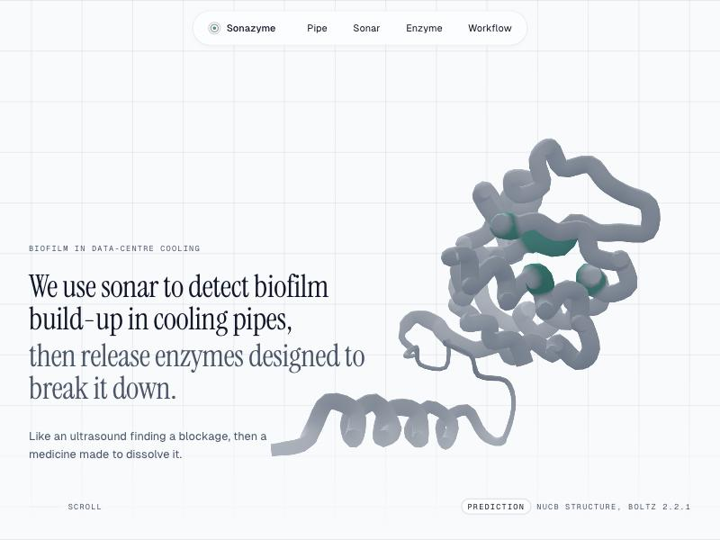
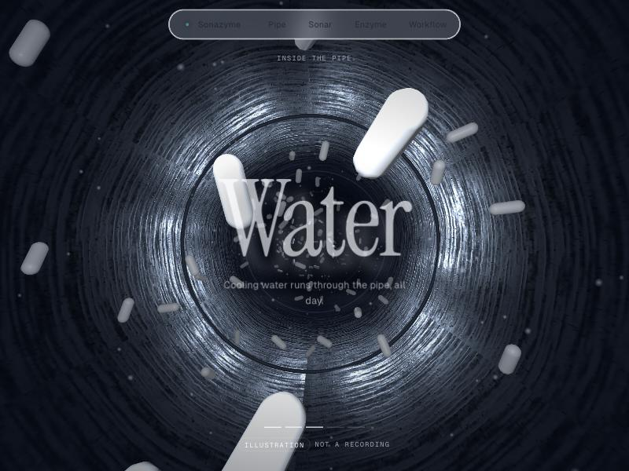
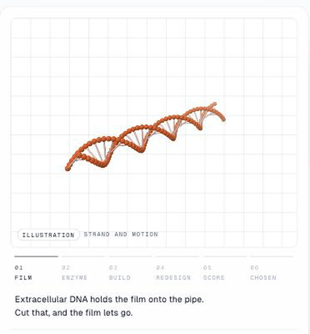
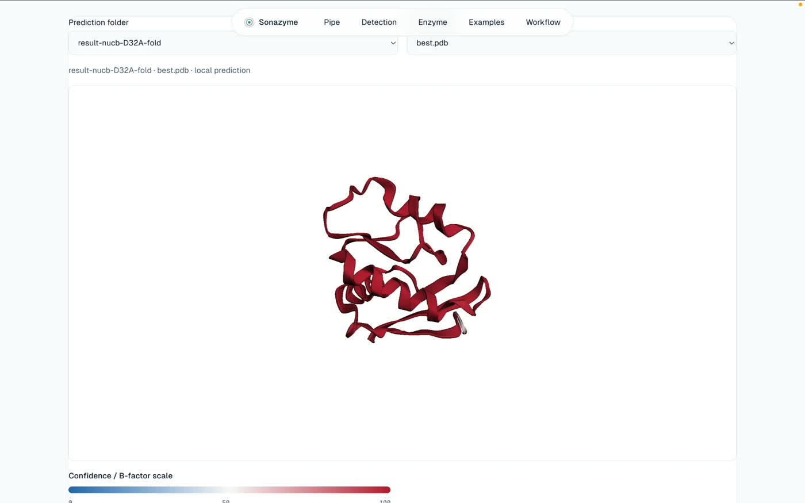
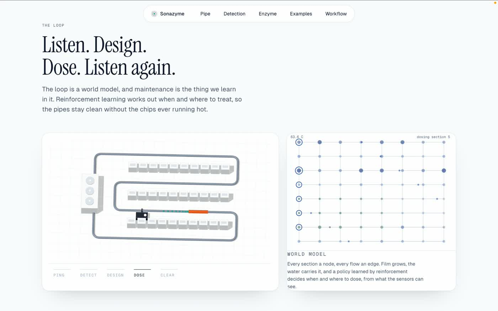

<div align="center">

# Sonazyme

**We use sonar to detect biofilm build-up in cooling pipes, then release
enzymes designed to break it down.**

[](LICENSE)
&nbsp;[](https://github.com/Nabzx/sonazyme/actions/workflows/ci.yml)
&nbsp;
&nbsp;

</div>

<p align="center"></p>

AI data centres are cooled with water. Bacteria live in that water, stick to
the pipe walls and build a slimy layer called a biofilm. It insulates the
metal, chokes the flow and throttles the chips. Operators dose the loop with
biocide, which kills the cells on the surface and leaves the glue they built,
so the film grows straight back.

Enzymes dissolve that glue properly. Ordinary ones fall apart in warm water
within minutes. Sonazyme designs ones that do not.

> Like an ultrasound finding a blockage, then a medicine made to dissolve it.

## The pipe is a sealed box

<p align="center"></p>

You cannot cut open a running loop, so we ping it. The echo at a boundary
depends on the two materials either side, and biofilm is mostly water, so the
signal barely moves. Our forward model says so plainly: hard scale is easy to
see, a soft film comes back with a wide interval, and anything under the
resolution floor is reported as undetermined rather than as a number.

## Designing an enzyme that survives the pipe

<p align="center"></p>

The film on the site runs the whole process. Find what holds the biofilm
together, pick the enzyme that cuts it, predict its shape with **Boltz-2**,
redesign it with **HyperMPNN on Tamarind Bio**, score every change, and keep
the one that leaves the cutting site intact.

The result that matters came from the scoring. A ranking model's fourth-best
mutation changed **Asn117**, one of the five catalytic residues, whose
equivalent mutant abolished activity in the literature. A stable but dead
enzyme at the top of a shortlist is the worst failure this project can have,
because it looks like a success. The active site is now excluded in the design
request itself, and 48 proposals were rejected on that rule.

<p align="center"></p>

Every surviving design is folded again, round after round. Pick any variant
from the list and look at it: thirty-one predictions from Boltz-2, ranked on
Tamarind Bio and scored by our Adaption model, coloured by the confidence the
folder itself reported.

## Knowing when to treat

<p align="center"></p>

A data centre that looks after itself. The layout is on the left, the same
loop as a world model on the right: every section a node, every flow an edge,
and the policy choosing when and where to dose.

The loop is a world model, and maintenance is the thing we learn in it.
Tabular Q-learning finds when and where to dose from what a sensor would
actually report. Scored on eight loops it never trained on, against doing
nothing and against a fixed schedule:

| | hours over ceiling | doses | peak | mean film |
| --- | --- | --- | --- | --- |
| untreated | 201 | 0 | 96.0 °C | 0.71 |
| fixed schedule | 0 | 20 | 76.2 °C | 0.53 |
| **learned** | **0** | 58 | **72.8 °C** | **0.21** |

```bash
python scripts/loop_policy.py     # trains and scores in about a second
```

The graph on the page is not a drawing of this. It loads the learned table and
runs the same dynamics in the browser.

## Run it

```bash
pip install -e ".[dev]"
python -m sonazyme.api --runs-dir runs --web-dir web
```

Then open `http://127.0.0.1:8000`. It runs with the network off.

## Honesty

Every number on the page carries the model that produced it, and anything
drawn rather than computed is labelled. The enzyme's shape is a real Boltz-2
prediction, the cutting site comes from the literature, the engineered region
is real design output. The sonar readings, the heat and the workflow are
illustrations and say so.

**Nothing here has been tested in a wet lab.** Predictions are not
measurements.

## The stack

| | |
| --- | --- |
| Structure prediction | Boltz-2 |
| Design and ranking | HyperMPNN, MutRank and ThermoMPNN on Tamarind Bio |
| Candidate scoring | a model fine-tuned with Adaption |
| Operator briefings | Synthesia |
| Dosing policy | tabular Q-learning over our own world model |
| Front end | plain ES modules and three.js, no build step |

## Where it goes

Anywhere water meets metal: shipping, water networks and spacecraft life
support, where nobody can be sent to scrub a pipe. The platform stays the
same. Only the target file changes.

## More

- [docs/biology/](docs/biology): every biological idea, at GCSE level
- [docs/adr/](docs/adr): why the project is built the way it is
- [docs/research/](docs/research): what we checked, including what did not work
- [CONTEXT.md](CONTEXT.md), [ROADMAP.md](ROADMAP.md), [CONTRIBUTING.md](CONTRIBUTING.md)

Apache 2.0. See [LICENSE](LICENSE).
