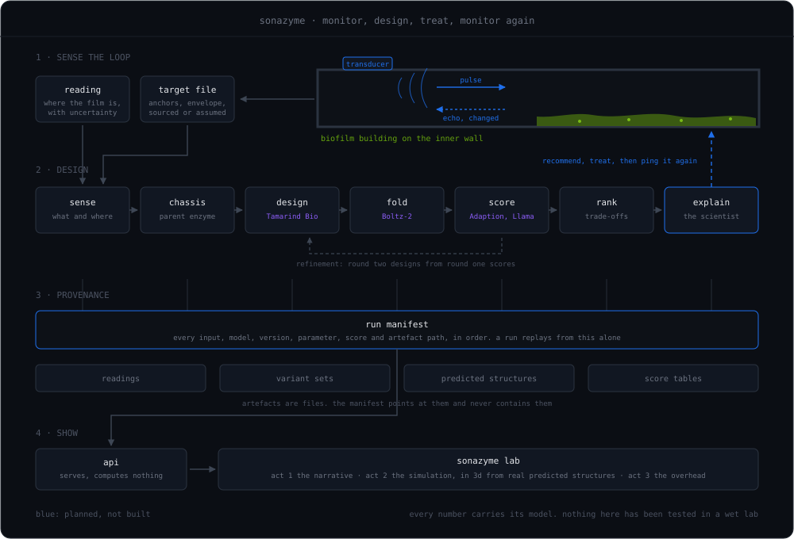

# Architecture

How Sonazyme fits together. The glossary is [CONTEXT.md](../../CONTEXT.md),
the biology underneath it is [docs/biology/](../biology), and the decisions
behind the shape are in [docs/adr/](../adr).

<p align="center">
  
</p>

## The shape of the thing

One pipeline, seven stages, one manifest per run.

```
targets/*.toml
      |
      v
  [ sense ]  ---> what holds this film together, and in what conditions
      |
      v
  [ chassis ] --> parent enzymes that cut those bonds, with sources
      |
      v
  [ design ] ---> variants of each chassis            (Tamarind Bio)
      |
      v
  [ fold ] -----> a predicted structure per variant   (Boltz-2)
      |
      v
  [ score ] ----> stability in the envelope, active-site integrity
      |                                               (Adaption Labs)
      v
  [ rank ] -----> the shortlist, with its trade-offs
      |
      v
  [ explain ] --> answers about this run, from this run   (the scientist)

          all seven append to ->  runs/<run-id>/manifest
                                  runs/<run-id>/artefacts/
                                        ^
                                        |
                              api/  -->  web/  (Sonazyme Lab)
```

## The stage contract

A stage is a function from a run manifest to a longer run manifest.

- It reads the manifest and the artefacts the manifest points at.
- It writes artefacts as files, and appends entries recording what it did:
  inputs, model, version, parameters, scores, artefact paths.
- It imports no other stage. Two implementations of the same stage are
  interchangeable if they read and write the same manifest fields.
- It is deterministic given its inputs and the recorded model version, or it
  records the seed that makes it so.

That contract is what makes a cached run replayable, which the demo depends on
([ADR-0006](../adr/0006-demo-track.md)), and what makes the scientist agent
checkable ([ADR-0004](../adr/0004-provenance-on-every-number.md)).

## The stages

### `sense`

Reads a target file and turns it into the run's working definition: the
anchors to attack, and the envelope to survive. Validates the target against
the schema, and carries through whether each value is sourced or assumed, so
an assumption stays visible downstream.

No model calls. The intelligence here is in the target file, which is data
([ADR-0002](../adr/0002-targets-are-data.md)).

**The acoustic front end, planned.** A loop is a sealed box, so `sense` is
meant to grow a second input: an acoustic survey of the loop, giving a map of
where fouling is building up, which picks the section a run is about and
closes the cycle of monitor, design, treat, monitor again. None of it is
built, its scope is fixed by an ADR first
([#57](https://github.com/Nabzx/sonazyme/issues/57)), and it inherits the
rules the rest of the repo runs on: a reading carries its provenance,
synthetic signals are labelled synthetic wherever they appear, and the model
behind a fouling estimate retrodicts before anyone trusts a number from it.

### `chassis`

For each anchor, selects one or more parent enzymes known to cut that bond,
with sequence, source and a defined active site. Records why each was chosen,
and folds each once to give the baseline structure and the baseline stability
estimate that redesigns have to beat.

### `design`

Proposes variants of a chassis, through Tamarind Bio. Mutations fall outside
the chassis active site by construction
([ADR-0005](../adr/0005-active-site-is-not-a-design-target.md)). Writes a
variant set: each variant's mutation set, and the strategy that produced it.

### `fold`

Predicts a structure for each variant, through Boltz-2, with confidence.
Where the run is modelling the enzyme against a fragment of its substrate,
this stage produces that complex too.

### `score`

Two things, in this order.

1. **Integrity check.** Does the variant's active-site geometry still match
   the chassis within tolerance? A failure rejects the variant, which stays in
   the manifest marked rejected.
2. **Stability estimate.** How well does the variant hold its fold in the
   envelope? Scoring runs through Adaption Labs, and a scoring model is
   trusted only after it retrodicts published measurements
   ([docs/validation/](../validation/README.md)).

### `rank`

Produces the shortlist. Multi-objective: predicted stability in the envelope,
predicted activity or its proxy, and model confidence. The trade-off front is
kept and shown rather than collapsed into one number, because stabilising an
enzyme often slows it ([docs/biology/08](../biology/08-what-makes-a-protein-stable.md)).

### `explain`

The scientist agent. Answers questions about the run using that run's
manifest and artefacts, citing what it used. If the run does not contain the
answer, it says so rather than reaching for general knowledge
([AGENTS.md](../../AGENTS.md), invariants).

## Runs and artefacts

```
runs/<run-id>/
  manifest.json        every stage entry, in order
  artefacts/
    chassis/           sequences, baseline structures
    variants/          mutation sets
    structures/        predicted structures, per variant
    scores/            score tables, per model
```

A run is identified, immutable once finished, and replayable from the manifest
alone. The demo ships with one such run cached, and any screen reading a
cached run says so.

## The service and the app

`api/` serves run manifests and artefacts to the dashboard, and nothing else.
It holds no second copy of the science, and it computes no number of its own:
if it is on screen, it came from a manifest entry. `web/` is Sonazyme Lab, and
its five screens are specified in [docs/design/dashboard.md](../design/dashboard.md).

## What this architecture buys

- **Swapping a target is a file.** Marine or spacecraft envelopes run the same
  stages.
- **Swapping a model is one stage.** A better structure predictor or a better
  stability model replaces one stage and leaves the rest alone.
- **Every claim is traceable.** Dashboard tile, agent sentence and shortlist
  row all lead back to a manifest entry naming the model that produced them.
- **The demo cannot drift from the system**, because it reads the same
  manifests the system writes.
